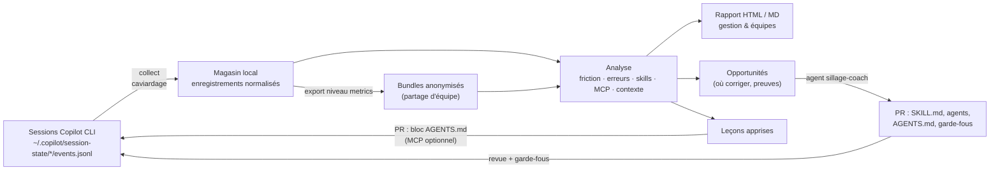

# Sillage

**Observatoire des sessions GitHub Copilot CLI et moteur d'auto-amélioration des agents, skills et instructions.**

> Le *sillage* est la trace qu'un navire laisse derrière lui. Chaque session Copilot laisse la sienne :
> Sillage la lit pour que les suivantes aillent plus vite.

Nos sessions Copilot produisent des milliers d'événements (appels d'outils, erreurs, corrections,
refus de permission, skills invoqués, sous-agents, tokens...). Aujourd'hui, ils dorment dans
`~/.copilot/session-state/` et **personne ne les exploite** : on ne sait pas quels skills aident ou nuisent,
quelles erreurs reviennent chaque semaine chez tout le monde, ni ce que coûte notre configuration MCP.

Sillage transforme ces journaux en trois choses :

1. **Visibilité** : un tableau de bord d'équipe (adoption, friction, échecs, coût en contexte, santé des
   skills/agents/serveurs MCP), **sans jamais classer les personnes**.
2. **Opportunités d'amélioration** priorisées et prouvées : « ce hook de garde-fou plante dans 39 sessions »,
   « ce skill est corrigé 0,7 fois par session », « `npm test` échoue dans ce dépôt, l'équipe contourne
   avec `npm run test:unit` »... avec **où** corriger (SKILL.md, .agent.md, AGENTS.md, hook, mcp-config).
3. **Leçons apprises réinjectées** dans les futures sessions par le `AGENTS.md` des dépôts (bloc idempotent,
   publié par PR) : la boucle d'auto-amélioration se ferme. **Aucun serveur MCP n'est requis** ; un serveur
   MCP optionnel (`sillage_lessons`) existe pour les organisations qui autorisent les MCP tiers.



## Démarrage rapide (WSL)

```bash
pipx install git+https://<votre-forge>/sillage.git   # ou : pip install -e .   (Python ≥ 3.11, aucune dépendance)
```

```bash
sillage demo                 # démonstration complète sur 150 sessions synthétiques -> ./sillage-demo/
```

```bash
sillage doctor               # vérifie où sont vos sessions, versions de Copilot, dérive de format
```

```bash
sillage report --since 30d --format html -o rapport.html
```

```bash
sillage opportunities --limit 10
```

```bash
sillage lessons --repo mon-org/mon-depot --write AGENTS.md
```

Sous WSL, Sillage lit `~/.copilot` **et** les sessions lancées côté Windows (`/mnt/c/Users/*/.copilot`).

## Commandes

| Commande | Rôle |
|---|---|
| `sillage collect` | Lit les sessions (incrémental) et met à jour le magasin local (`~/.local/share/sillage`). |
| `sillage report` | Rapport `md` (défaut), `html` (tableau de bord autonome) ou `json`. |
| `sillage opportunities` | Opportunités priorisées : preuves, action proposée, où corriger. `--category`, `--format json`. |
| `sillage lessons` | Leçons apprises ; `--repo`, `--skill`, `--write AGENTS.md`, `--format agents-md`. |
| `sillage export` | Bundle `.jsonl.gz` anonymisé à partager (niveau `metrics` par défaut). |
| `sillage report --bundle-dir <dossier>` | Vue d'équipe à partir des bundles déposés dans un dossier partagé. |
| `sillage copilot-install` | Installe l'agent `sillage-coach` et le skill `sillage-amelioration` dans `~/.copilot`. |
| `sillage mcp` | *Optionnel* : serveur MCP stdio en lecture seule, si la politique de l'organisation autorise les MCP tiers. |
| `sillage doctor` | Diagnostic : sessions trouvées, versions de Copilot CLI, types d'événements inconnus. |
| `sillage init-config` | Écrit un `sillage.toml` commenté (seuils, confidentialité, motifs de correction). |

Options communes : `--since 30d|12w|2026-10-01`, `--repo owner/nom`, `--bundle-dir <dossier>`,
`--copilot-home <dir>`, `-o fichier`.

**Déploiement en équipe pas à pas** (rôles, planification Windows, publication des leçons) :
[docs/flux-equipe.md](docs/flux-equipe.md).

## Ce que Sillage détecte

| Signal | Exemple d'opportunité | Où corriger |
|---|---|---|
| Erreur d'outil récurrente (signature normalisée) + **contournement observé** | `mvn test` échoue (PKIX) dans 31 sessions ; solution vue 12 fois : `mvn -s ~/.m2/settings-dp.xml test` | AGENTS.md du dépôt |
| Skill souvent corrigé après invocation | « servicenow-incident » : 0,7 correction / session | SKILL.md |
| Skill dormant (chargé partout, jamais déclenché) | « confluence-recherche » : 0 % d'activation | description du skill |
| Serveur MCP qui ne démarre pas / appels en échec | « dynatrace » : 53 sessions sans le serveur | mcp-config.json |
| Sous-agent instable, définition d'agent invalide | « aq-tests » échoue dans 53 % des cas | .agent.md |
| Refus humains répétés → garde-fou manquant | `git push` refusé 36 fois | hook / règle deny + instructions |
| Approbations répétées → bruit de permissions | `git status` approuvé 265 fois | profil d'autorisations |
| Hook de garde-fou qui plante | `preToolUse : jq: not found` dans 39 sessions | .github/hooks |
| Coût en contexte | définitions d'outils = 16 % de la fenêtre ; `terraform plan` = 28 000 car. / appel | profils MCP, compression |
| Dépôt à forte friction, boucles d'échec | `dp/portail-citoyen` : 14 boucles | AGENTS.md |

Détails des calculs : [docs/methodologie.md](docs/methodologie.md).

## Intégration Copilot CLI (sans MCP)

```bash
sillage copilot-install
```

* **Leçons dans AGENTS.md** : `sillage lessons --bundle-dir <partage> --repo owner/nom --write AGENTS.md`
  ou `examples/publier-lecons.sh` pour ouvrir une PR par dépôt. Copilot lit AGENTS.md nativement : aucune
  installation ni autorisation n'est nécessaire chez les personnes qui en profitent.
* **Agent `sillage-coach`** : `copilot --agent sillage-coach --allow-tool='shell(sillage:*)'`. Il lit les
  opportunités avec la CLI, propose le plus petit correctif et ouvre une PR avec les preuves. Il ne
  fusionne jamais seul : vos garde-fous et revues s'appliquent.
* **Skill `sillage-amelioration`** : permet de demander en langage naturel « comment se passent nos sessions ? ».
* **Optionnel, si les serveurs MCP tiers sont autorisés** : `sillage copilot-install --mcp` ajoute le
  serveur `sillage` (outils `sillage_lessons`, `sillage_opportunities`, `sillage_overview`,
  `sillage_skill_health`) pour consulter la mémoire collective en direct pendant une session.

## Confidentialité et éthique (résumé)

* **Rien ne quitte le poste** sans `sillage export` explicite.
* Le magasin local ne contient **jamais** les journaux bruts : seulement compteurs, noms d'outils/skills,
  signatures d'erreurs normalisées et (niveau `redacted`) de courts extraits **caviardés** (jetons, courriels,
  IP, NAS, cartes, chemins personnels...).
* Les bundles partagés sont au niveau `metrics` par défaut : **aucun texte libre**, identifiants re-pseudonymisés.
* **Aucun classement individuel**, k-anonymat sur les extraits dans les rapports d'équipe.

Charte complète : [docs/gouvernance.md](docs/gouvernance.md).

## Compatibilité

Format d'entrée : journaux `events.jsonl` de **GitHub Copilot CLI 1.0.x**, conformes au schéma
`session-events.schema.json` livré dans le paquet npm `@github/copilot`. Le lecteur est tolérant (champs
manquants, lignes tronquées, types inconnus) et `sillage doctor` signale toute dérive de format après une
mise à jour de Copilot. Python 3.11+, bibliothèque standard uniquement (adapté aux postes corporatifs).

## Développement

```bash
pip install -e '.[dev]'
```

```bash
ruff check . && pytest -q
```

Feuille de route : [docs/feuille-de-route.md](docs/feuille-de-route.md).
