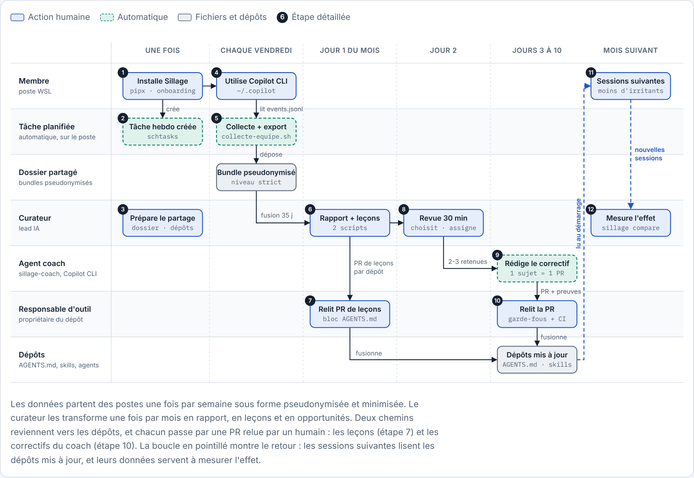

# Sillage

**Observatoire des sessions GitHub Copilot CLI et boucle d'auto-amélioration des agents, skills et instructions.**

Chaque session Copilot laisse une trace dans `~/.copilot/session-state/`. Sillage la lit, sans serveur MCP
et sans aucune dépendance (Python 3.11+), pour :

1. **montrer** à la gestion l'adoption, la friction et le coût, sans jamais classer les personnes ;
2. **trouver** quoi corriger (skill, agent, AGENTS.md, hook, MCP, permissions), avec les preuves et l'endroit ;
3. **réinjecter** les leçons dans les sessions suivantes par le `AGENTS.md` des dépôts, puis **prouver**
   l'effet avant/après.

[](docs/flux-equipe.md)

## Démarrer le pilote

| # | Qui | Quoi | Commande |
|---|---|---|---|
| 1 | Responsable du pilote | Installer et faire **son** onboarding en premier : valide Sillage sur de vrais journaux et produit le `sillage.toml` d'équipe | voir ci-dessous |
| 2 | Responsable | Créer le dossier partagé (écriture pour tous, lecture pour le curateur seulement), puis vérifier les [critères de démarrage](docs/guide-agent-onboarding.md#critères-de-démarrage-du-pilote) | — |
| 3 | Chaque participant | Installer, faire son onboarding (20 min), planifier la collecte du vendredi | [flux-equipe.md §1-2](docs/flux-equipe.md) |
| 4 | Curateur, une fois par mois | Rapport, revue de 30 min, publication des leçons par PR | `examples/rapport-equipe.sh` · `examples/publier-lecons.sh` |
| 5 | Responsable d'outil | Faire rédiger le correctif d'une opportunité retenue (PR relue, jamais fusionnée seule) | `copilot --agent sillage-coach` |
| 6 | Curateur, 2 à 4 semaines après | Mesurer l'effet du correctif | `sillage compare --pivot <date>` |

### Installation et onboarding (étapes 1 et 3)

```bash
pipx install git+https://github.com/boisvertmathieu/sillage.git   # ou : pip install --user sillage-*.whl
sillage copilot-install
copilot --agent sillage-onboarding --allow-tool='shell(sillage:*)'
```

L'agent analyse **tout votre historique** avec `sillage onboard`. Il vérifie :

- le format des journaux et les sessions WSL ou Windows ;
- les textes qui sortiraient d'un export ;
- le lexique de corrections ;
- les dépôts et les clones ;
- l'usage dans l'IDE ;
- l'installation.

Il propose les réglages, écrit après votre accord et ne pose que les questions non déductibles.
Détails : [guide de l'agent d'onboarding](docs/guide-agent-onboarding.md).

Pour essayer sans données : `sillage demo` (150 sessions synthétiques dans `./sillage-demo/`).

## Commandes

| Commande | Rôle |
|---|---|
| `sillage onboard` | Diagnostic sur tout l'historique : points flous, motifs de caviardage, questions. `--partageable`, `--depots`. |
| `sillage doctor` | Sessions trouvées, versions de Copilot, dérive de format. |
| `sillage collect` | Lecture incrémentale des sessions vers le magasin local. |
| `sillage report` | Rapport `md`, `html` (tableau de bord autonome) ou `json`. |
| `sillage opportunities` | Opportunités priorisées : preuves, action, où corriger. |
| `sillage lessons --repo o/n --write AGENTS.md` | Bloc de leçons idempotent pour un dépôt. |
| `sillage compare --pivot DATE` | Indicateurs et opportunités avant / après un correctif (`--id`, `--window`). |
| `sillage export -o f.jsonl.gz` · `--preview` | Bundle pseudonymisé (niveau `strict` par défaut) ; `--preview` affiche tout le texte qui sortirait. |
| `sillage inspect <bundle>` | Tout le texte contenu dans un bundle. |
| `sillage copilot-install` | Agents `sillage-onboarding` et `sillage-coach`, skill `sillage-amelioration`. |
| `sillage init-config` | `sillage.toml` commenté (confidentialité, seuils, lexique). |

Options communes : `--since 30d`, `--repo owner/nom`, `--bundle-dir <partage>` (vue d'équipe),
`--copilot-home <dir>`, `-o fichier`. Le serveur MCP `sillage mcp` est optionnel : il sert seulement si la
politique de l'organisation autorise les MCP tiers.

## Confidentialité en bref

- Rien ne quitte le poste sans `sillage export`, ou la tâche planifiée que la personne a elle-même créée.
- Export `strict` par défaut : ni prompt, ni code, ni sortie, ni mot issu d'un message d'erreur, seulement
  un type et une empreinte (`reseau#9f3a1c2e`).
- Caviardage intégré, plus les motifs de l'organisation (`[confidentialite]`) proposés par l'onboarding.
- Identité pseudonymisée avec un sel **local au poste** ; aucune vue par personne. Les dépôts utilisés par
  moins de *k* personnes sont regroupés.

Charte complète et procédure pour les sessions qui touchent la production : [docs/gouvernance.md](docs/gouvernance.md).

## Pour aller plus loin

[Flux d'équipe pas à pas](docs/flux-equipe.md) · [Guide de l'agent d'onboarding](docs/guide-agent-onboarding.md) ·
[Méthodologie et règles](docs/methodologie.md) · [Feuille de route](docs/feuille-de-route.md)

Compatibilité : journaux `events.jsonl` de Copilot CLI 1.0.x, lus d'après les types de `@github/copilot-sdk`
(lecture tolérante) ; Linux, WSL, Windows natif et macOS.
Développement : `pip install -e '.[dev]' && ruff check . && pytest -q`.
