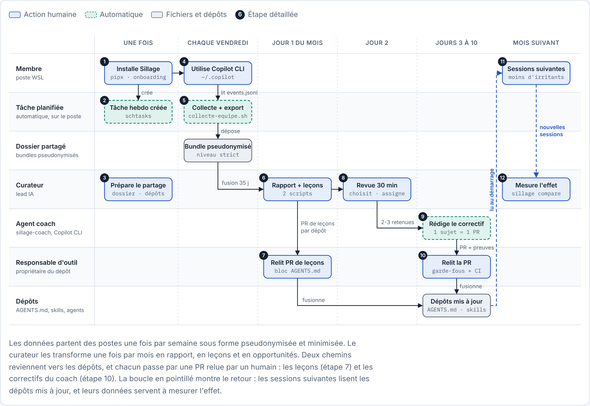

# Flux d'équipe : de la session Copilot à l'amélioration des outils

Ce flux fonctionne **sans serveur MCP** : il convient aux organisations dont la politique Copilot
désactive les serveurs MCP tiers. Tout passe par la ligne de commande `sillage`, un dossier partagé
et le fichier `AGENTS.md` des dépôts, que Copilot lit nativement.



Version complète, avec les 12 étapes détaillées et les points de contrôle humains : ouvrir
[flux-equipe.html](flux-equipe.html) dans un navigateur (fichier autonome, à partager tel quel).

## Rôles

| Rôle | Qui | Effort |
|---|---|---|
| Contributeur | chaque membre qui utilise Copilot CLI | 20 min une fois (onboarding), puis automatique |
| Curateur | lead IA (ou personne désignée) | ~1 h par mois |
| Responsable d'outil | propriétaire d'un skill, agent, hook ou dépôt | revue de PR |

## 1. Installation et onboarding (contributeur, une fois)

```bash
pipx install git+https://github.com/boisvertmathieu/sillage.git
```

Sans accès à github.com depuis le poste : récupérer la roue (`sillage-*.whl`, artefact `sillage-wheel`
de la CI) sur un partage interne, puis `pip install --user sillage-*.whl`. Aucune dépendance.

```bash
sillage copilot-install
copilot --agent sillage-onboarding --allow-tool='shell(sillage:*)'
```

L'agent d'onboarding analyse **tout l'historique** du poste avec `sillage onboard` et lève les points
flous : format des journaux, sessions WSL/Windows, motifs de caviardage, lexique de corrections, dépôts,
usage dans l'IDE, installation. Il ne pose que les questions non déductibles. Le **responsable du pilote
le fait en premier** sur son propre poste. Détails et critères de démarrage :
[guide-agent-onboarding.md](guide-agent-onboarding.md). Sans l'agent : `sillage onboard`.

## 2. Collecte hebdomadaire (contributeur, automatique)

`examples/collecte-equipe.sh` exécute `sillage collect` puis `sillage export` (niveau `strict` par défaut)
vers `$SILLAGE_PARTAGE/<année-semaine>/<nom-aléatoire>.jsonl.gz`. Le bundle ne contient ni prompt, ni code,
ni sortie brute, ni texte de message d'erreur. Avant d'activer la tâche, chaque participant lance une fois
`sillage export --preview` pour voir tout le texte qui sortirait (voir [gouvernance.md](gouvernance.md)).

**Windows natif (sans WSL)** : `examples/collecte-equipe.ps1`, avec la commande de planification en tête
du script.

**Planification recommandée sous WSL : Planificateur de tâches Windows.** Le `cron` de WSL ne tourne que si WSL
est démarré. Une tâche Windows hebdomadaire est plus fiable (remplacer le chemin du partage) :

```bash
schtasks.exe /Create /SC WEEKLY /D FRI /ST 16:17 /TN "Sillage collecte" /TR "wsl.exe -e bash -lc 'SILLAGE_PARTAGE=/mnt/p/equipe-ia/sillage ~/sillage/examples/collecte-equipe.sh'"
```

## 3. Rapport mensuel (curateur)

```bash
SILLAGE_PARTAGE=/mnt/p/equipe-ia/sillage ./examples/rapport-equipe.sh
```

Le script produit le tableau de bord HTML (pour la gestion) et `…-opportunites.md`. Équivalent manuel :
`sillage report --bundle-dir /mnt/p/equipe-ia/sillage --since 35d --format html -o rapport.html`.

Revue de 30 minutes : retenir 2 ou 3 opportunités, nommer un responsable pour chacune.

## 4. Auto-amélioration (responsable d'outil ou curateur)

Dans le dépôt qui contient la cible (skills, agents, hooks, dépôt applicatif) :

```bash
copilot --agent sillage-coach --allow-tool='shell(sillage:*)'
```

Puis, par exemple : « Traite l'opportunité la plus prioritaire de `--bundle-dir /mnt/p/equipe-ia/sillage`
qui concerne ce dépôt ». Le coach lit les opportunités avec la CLI, propose le plus petit correctif et
ouvre une PR avec les preuves. Il ne fusionne jamais : revue humaine et garde-fous s'appliquent.

## 5. Réinjection des leçons (curateur, mensuel)

Sans MCP, **AGENTS.md est le canal principal** : Copilot le lit au début de chaque session, sans
installation ni autorisation supplémentaire, y compris chez les personnes qui n'ont pas Sillage.

```bash
SILLAGE_PARTAGE=/mnt/p/equipe-ia/sillage ./examples/publier-lecons.sh depots.txt
```

`depots.txt` liste `owner/nom  /chemin/du/clone` par ligne (brouillon : `sillage onboard --depots depots.txt`).
Une leçon d'erreur ne va que dans les dépôts où l'erreur a été vue. Pour chaque dépôt, le script régénère le
bloc Sillage d'AGENTS.md (idempotent) et ouvre une PR seulement s'il a changé. Ajoutez une fois
l'extrait `sillage/assets/copilot/instructions-snippet.md` au AGENTS.md de chaque dépôt.

## 6. Mesure de l'effet

2 à 4 semaines après la fusion d'un correctif :

```bash
sillage compare --bundle-dir /mnt/p/equipe-ia/sillage --pivot 2026-12-05
```

Chaque opportunité est ramenée à 100 sessions avant et après la date pivot (28 jours de chaque côté par
défaut, `--window`) : « résolue », « en baisse », « stable », « en hausse » ou « nouvelle ».
`--id <identifiant>` isole l'opportunité traitée par une PR du coach. C'est la preuve à présenter à la
gestion.

## Si la politique MCP est activée plus tard

Rien ne change dans ce flux ; on peut **en plus** offrir la mémoire collective en direct :

```bash
sillage copilot-install --mcp
```

puis remplacer, dans `~/.copilot/mcp-config.json`, `"args": ["mcp"]` par
`"args": ["mcp", "--bundle-dir", "/mnt/p/equipe-ia/sillage"]` pour servir les leçons de toute l'équipe.
